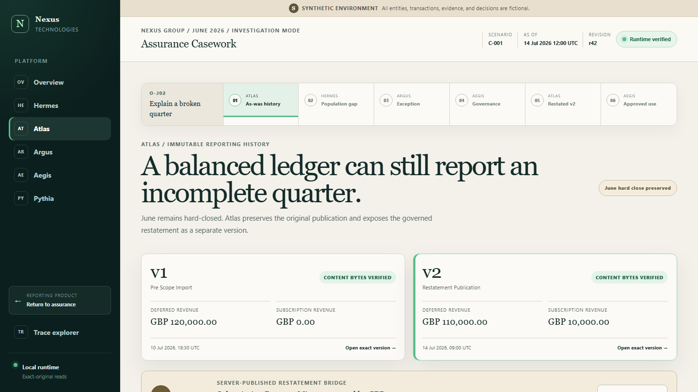
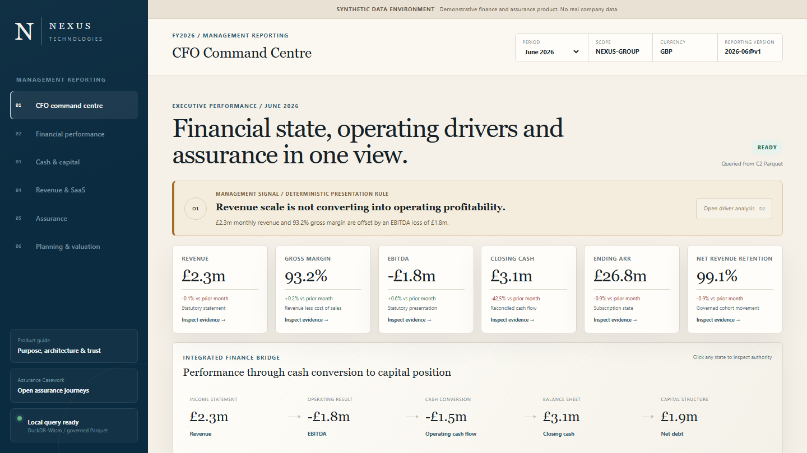
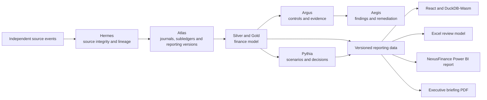

# Finance & Assurance Platform

**v1.0**

A synthetic company's finance function, built end to end, so the whole chain an
auditor tests can be seen at once: source systems that disagree, transactions
that arrive twice or arrive late, the journals derived from them, the period
close, the controls, the evidence, and the reporting management uses.

I built it to understand the system behind individual audit tasks: how a source
problem reaches the accounts, why a reconciliation can pass while reporting is
still wrong, and how a correction should be investigated, approved and recorded.

All companies, transactions and results in this portfolio are fictional.

## Review the portfolio

- [Accounting case walkthrough](#a-balanced-ledger-an-incomplete-quarter) follows a journal deferred at close through to the approved restatement.
- [Excel financial model](consumer-products/excel/README.md) shows the completed three-statement forecast, scenario controls and DCF, with a preview from the reviewed workbook.
- [Power BI screenshot gallery](docs/public-release/power-bi/README.md) shows the live Desktop report, including KPI eligibility and reporting-version evidence.
- [Executive deck (PDF)](docs/public-release/Nexus-June-2026-Executive-Deck.pdf) turns the June cash and facility evidence into a decision for Treasury and FP&A.

## Audit work covered

| The work | Where it shows up |
|---|---|
| Revenue completeness and period close | The [June walkthrough](#a-balanced-ledger-an-incomplete-quarter) follows an authorised deferral, a July adjustment and a restated June report. |
| Controls testing and follow-up | The platform has 64 independent finance controls. In the [C-001 control trail](docs/product/canonical-transaction-c001.md), a completeness exception becomes a finding and an issue with an approved correction. |
| Source completeness and transaction-to-statement trail | Source IDs keep duplicates and late arrivals distinguishable all the way to the accounts. The [Transaction Explorer](#explore-the-close-decision-locally) connects case records to journals, statement lines and controls. |
| Forecasting and liquidity | The [Excel model](consumer-products/excel/README.md) runs a 60-month forecast. The [June deck](docs/public-release/Nexus-June-2026-Executive-Deck.pdf) turns the cash and facility figures into a decision. |

## A balanced ledger, an incomplete quarter

The controller authorises deferral of a GBP 10,000 subscription revenue journal
proposal under the close policy. Nexus then hard-closes June with the ledger
in balance. The first June report leaves that GBP 10,000 in deferred revenue.

A balanced ledger proves the arithmetic. Completeness is a separate question.
Argus runs the contract-to-revenue control (`ARG-O2C-002`) automatically. It
expects one posted June recognition journal, finds none and raises a blocking
exception for the GBP 10,000 gap. An adjustment posts in July. The CFO approves
a restatement of the June figures. Both published versions stay available.

| Reporting version | Subscription revenue | Deferred revenue |
|---|---:|---:|
| Original June report | GBP 0 | GBP 120,000 |
| Revised June report | GBP 10,000 | GBP 110,000 |



## Explore the close decision locally

Search for an exact record reference in the Transaction Explorer to see how
it connects to a journal, a statement line and the control that checked it.

In the Period-Close Cockpit, simulate posting the missing journal before close
or authorising a deferral. Open the outcome in the explorer and compare it with
the recorded case. [Local setup](#technical-detail-and-local-setup) ·
[Web routes](web/README.md)

## Management reporting views

The web app brings together financial performance, cash and capital,
subscription metrics, assurance and control readiness, and planning and
valuation. Actuals and scenario results keep separate histories, so each
number retains its own basis.

I built the Power BI report so a reader can start with a figure and trace it
back to the reporting version that produced it. A KPI can appear for CFO
review and be withheld for statutory sign-off. The report tells you why.
[Power BI gallery](docs/public-release/power-bi/README.md)

### CFO command centre



### Assurance and control readiness


## Excel financial model

The Excel model connects 66 months of Nexus Group actuals to a 60-month
forecast across the income statement, balance sheet and cash flow. Change a
driver and see how all three statements move. The workbook includes three
scenarios, monthly reconciliation checks and a DCF that withholds valuation
when its funding or terminal cash flow tests fail.

The reviewed `Nexus-Financial-Model.xlsx` lives outside Git. The repository has
the workbook preview, model specification, builder and validation notes.
[Review the Excel model](consumer-products/excel/README.md)

## Executive briefing

I opened the June deck with the cash split. Nexus reports GBP 33.58m of available
liquidity, and GBP 30.50m of that is undrawn capacity. The deck asks Treasury
to confirm the draw terms and FP&A to forecast cash through 30 September.
A 13-week forecast from the June close ends on 29 September, one day short of
quarter-end.

The appendix gives the source table and calculation for every figure. The
build checks the claims against the published data and stops if any claim
fails. [Executive deck (PDF)](docs/public-release/Nexus-June-2026-Executive-Deck.pdf) ·
[Deck generator](consumer-products/executive-briefing/README.md)

## Technical detail and local setup

<details>
<summary>Open the engineering inventory, architecture, scale, setup and validation</summary>

### Engineering inventory

- The source generator simulates defects, duplicates and late arrivals across finance systems.
- Hermes preserves source IDs and ingests immutable Bronze records.
- Atlas applies double-entry posting rules and maintains the subledgers and reporting versions.
- The financial statements cover 66 reconciled months, with detail on fixed assets, banking, debt, leases, tax, equity, intercompany, procurement, billing, workforce and subscriptions.
- Typed Silver models feed Gold facts, dimensions and reporting tables.
- Argus runs controls. Aegis records which exceptions reviewers turn into findings and tracks how each finding is resolved.
- Pythia publishes scenario results, liquidity projections and valuation readiness.
- The React app queries authenticated Parquet in the browser with DuckDB-Wasm.

### Architecture



The platform records what happened in the business, what each source recorded,
what the ledger posted, and what reviewers approved for a particular use. Only
business events drive posting rules. Accounting events record actions such as
closing a period or publishing a restatement.

[Architecture and module ownership](docs/public-release/architecture.md) ·
[Artifact policy](docs/public-release/artifact-policy.md) ·
[Reproducibility](docs/public-release/reproducibility.md)

### Scale

| Layer | Published data and model scale |
|---|---:|
| Source and Bronze datasets | 78 |
| Source/Bronze rows | 4,227,015 |
| Historical periods | 66 months |
| Typed Silver views | 70 |
| Gold datasets | 99 |
| Model relationships | 187 |
| Measure specifications | 189 |
| dbt tests | 387 |
| Independent finance controls | 64 |
| React runtime Parquet partitions | 114 |
| Pythia forecast results | 360 scenario-months |

### Quick start

You need the following tools.

- Python 3.13
- [uv](https://docs.astral.sh/uv/) 0.11.32
- Node.js 22.13 or newer

Install the locked Python and web dependencies and prepare the browser runtime.

```bash
uv sync --locked --dev
npm --prefix web ci
npm --prefix web run prepare:duckdb
```

Start the complete local product, including the assurance API and React app.

```bash
uv run --locked python public_product.py serve
```

Open `http://127.0.0.1:3000`.

To run the finance screens on their own, start the frontend from `web`.
The casework, explorer and cockpit use the full launcher above.

```bash
cd web
npm ci
npm run dev
```

The repository includes the browser dataset. The preparation command builds the
local DuckDB-Wasm runtime from pinned dependencies. Queries run in your browser.

### Validation

```bash
uv run ruff check .
uv run pytest -q
uv run python scripts/check_public_release.py

cd web
npm ci
npm run lint
npm run typecheck
npm run test:finance
npm test
```

### Repository map

```text
src/finance_assurance/   Python domain, runtime, generators and services
models/                  dbt Silver, Gold and governance models
macros/                  dbt macros
tests/                   Python, SQL and contract tests
web/                     React/vinext finance product
consumer-products/       Excel, Power BI and executive briefing workspaces
docs/architecture/       Ratified architecture contracts and ADR log
docs/product/            Product and analytical contracts
docs/roadmap/            Implemented milestone records
docs/public-release/     Public architecture, artifacts and reproduction guide
scripts/                 Release and supporting build utilities
```

The [milestone index](docs/roadmap/README.md) records what changed along the way.
The [artifact policy](docs/public-release/artifact-policy.md) explains which files
Git tracks and where the generated warehouses and desktop binaries live.

</details>

## Project status and use

The journals have to balance, every restatement keeps its approval trail, and
every figure in the deck traces back to the data it came from.

A clean checkout includes the data that powers the web app. GitHub Actions runs
the Python and web checks on every push.

External contributions are closed. Please use GitHub's private reporting
channel for [security reports](SECURITY.md).
[MIT License](LICENSE) · [Portfolio and data disclaimer](DISCLAIMER.md)
