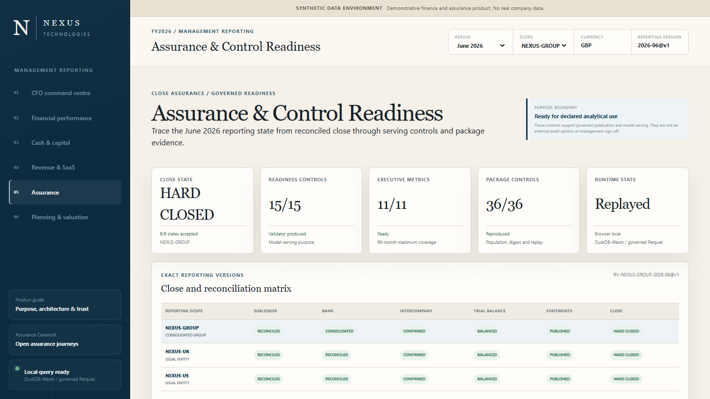
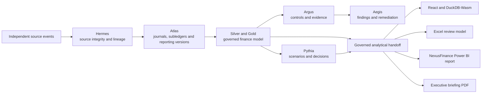

# Finance & Assurance Platform

A synthetic company's finance function, built end to end, so the whole chain an
auditor tests can be seen at once: source systems that disagree, transactions
that arrive twice or arrive late, the journals derived from them, the period
close, the controls, the evidence, and the reporting management uses.

I built it to understand the system behind individual audit tasks: how a source
problem reaches the accounts, why a reconciliation can pass while reporting is
still wrong, and how a correction should be investigated, approved and recorded.

> **Scope:** all entities, transactions and results are fictional. This is a
> portfolio demonstration, not an audit opinion, investment recommendation or
> production accounting system.

## Review the portfolio

- [Accounting case walkthrough](#start-with-this-example-a-balanced-ledger-an-incomplete-quarter) follows a missed posting from the closed accounts to the approved restatement.
- [Power BI screenshot gallery](docs/public-release/power-bi/README.md) shows the live Desktop report, including KPI eligibility and reporting-version evidence.
- [Executive deck (PDF)](docs/public-release/Nexus-June-2026-Executive-Deck.pdf) turns the June cash and facility evidence into a decision for Treasury and FP&A.

## Start with this example: a balanced ledger, an incomplete quarter

In the subscription-revenue example, a GBP 10,000 recognition journal is not
posted before the reporting period closes. The ledger still balances, but
revenue is understated and deferred revenue is overstated.

The walkthrough follows the unresolved recognition through evidence, review,
approval and a revised reporting version. The original closed-period report is
preserved rather than silently overwritten.

| Reporting version | Subscription revenue | Deferred revenue |
|---|---:|---:|
| Original June report | GBP 0 | GBP 120,000 |
| Revised June report | GBP 10,000 | GBP 110,000 |


**What this demonstrates:** testing whether debits equal credits is not the same
as establishing completeness. The investigation needs the expected recognition
population, the posting history and evidence supporting the treatment of the
unposted item.

This written example and screenshot can be reviewed without installing the
product. To inspect the interactive journey, expand the
[local setup instructions](#technical-detail-and-local-setup) below; the
[reproduction guide](docs/public-release/reproducibility.md)
explains how the underlying outputs are checked.

## What the work demonstrates

| Familiar workstream | Demonstration in the platform |
|---|---|
| Source-data completeness and reconciliation | Retain the identity of records, distinguish duplicates and late arrivals, and trace discrepancies through the accounting process |
| Revenue completeness and period close | Compare expected recognition with posted reporting, investigate an unposted item and preserve the original closed-period state |
| Transaction-to-statement audit trail | Follow business events through posting rules, journals, subledgers and financial statements |
| Corrections and reporting revisions | Keep an open-period correction distinct from a revised reporting version, with evidence and approvals retained |
| Controls testing and exception follow-up | Produce reviewable evidence and distinguish an automated exception from a finding, remediation and sign-off |
| Liquidity and financial analysis | Run scenarios over controlled actuals with stated assumptions and retain the published model results |

These examples demonstrate work relevant to audit, data assurance and finance
transformation: investigating discrepancies, documenting accounting consequences
and making results reviewable. Automated checks support those tasks; they do not
replace professional judgement or constitute an audit conclusion.

## Explore the close decision locally

The Transaction Explorer lets you search by exact record reference and follow
the evidence through posting, reporting and assurance. In the Period-Close
Cockpit, you can simulate correcting the missed recognition before close or
carrying it into the published period, then open the corresponding path in the
explorer. The simulation leaves the published evidence intact.

[Start the local app](#technical-detail-and-local-setup) and use the
Transaction Explorer and Period-Close Cockpit links in its navigation.
[Web routes and setup](web/README.md)

## Management reporting views

The product contains six management screens: CFO overview, financial performance,
cash and capital, revenue and subscription economics, assurance and control
readiness, and planning and valuation.

Reported actuals and scenario results keep separate histories. The interface
presents those controlled outputs rather than calculating a second version of
the accounts.

### CFO command centre


### Assurance and control readiness



## Executive briefing

The June 2026 close as a twelve-slide deck: liquidity, the debt facility, cash
movement, profitability, recurring revenue, working capital, close assurance and
the decision requested of Treasury and FP&A. Every figure on a slide traces to a
row in the evidence appendix, naming its source table and derivation.

[Read the deck (PDF)](docs/public-release/Nexus-June-2026-Executive-Deck.pdf).
It is rebuilt from the sealed delivery by
[`consumer-products/executive-briefing`](consumer-products/executive-briefing/README.md),
which asserts each claim the slides make and fails rather than print one the data
no longer supports.

## Technical detail and local setup

<details>
<summary>Open the engineering inventory, architecture, scale, setup and validation</summary>

**Release target:** `v0.1 - Governed Finance Platform + React Intelligence Product`

### Engineering inventory

- realistic multi-system finance event generation with defects, duplicates and late-arriving records;
- immutable Bronze ingestion and source identity through Hermes;
- rules-driven double-entry accounting, subledgers and reporting versions in Atlas;
- 66 months of reconciled income statement, balance-sheet and cash-flow history;
- fixed assets, banking, debt, leases, tax, equity, intercompany, procurement, billing, workforce and SaaS operating depth;
- typed Silver models and governed Gold facts, dimensions and executive marts;
- Argus control execution and Aegis evidence, finding and remediation journeys;
- governed Pythia scenario, liquidity and valuation-readiness outputs; and
- a serverless React product querying authenticated Parquet locally with DuckDB-Wasm.

### Architecture



The platform keeps business-event truth, source-system truth, accounting truth
and governed truth distinct. Only business events may drive posting rules;
accounting lifecycle events never re-enter the posting engine.

[Architecture and module ownership](docs/public-release/architecture.md) ·
[Artifact policy](docs/public-release/artifact-policy.md) ·
[Reproducibility](docs/public-release/reproducibility.md)

### Scale and governed state

| Layer | v0.1 position |
|---|---:|
| Source and Bronze datasets | 78 |
| Source/Bronze rows | 4,227,015 |
| Historical periods | 66 months |
| Typed Silver views | 70 |
| Governed Gold datasets | 99 |
| Governed relationships | 187 |
| Governed measure specifications | 189 |
| dbt tests | 387 |
| Independent finance controls | 64 |
| React runtime Parquet partitions | 114 |
| Pythia forecast results | 360 scenario-months |

### Quick start

Prerequisites:

- Python 3.13
- [uv](https://docs.astral.sh/uv/) 0.11.32
- Node.js 22.13 or newer

Install the locked Python environment:

```bash
uv sync --locked --dev
```

Start the complete local product, including the finite assurance API and React application:

```bash
uv run --locked python public_product.py serve
```

Open `http://127.0.0.1:3000`.

For the finance-intelligence frontend only (the Assurance Casework routes require
the complete launcher above):

```bash
cd web
npm ci
npm run dev
```

The repository includes the compact, governed v0.1 browser dataset. The pinned
DuckDB-Wasm module is prepared from `node_modules`; no hosted database, API key
or external company dataset is required.

### Validation

```bash
uv run ruff check .
uv run pytest -q
uv run python scripts/check_public_release.py

cd web
npm ci
npm run lint
npm run typecheck
npm run test:finance
npm test
```

GitHub Actions executes the same Python, public-hygiene and web gates on every
push and pull request.

### Repository map

```text
src/finance_assurance/   Python domain, runtime, generators and services
models/                  dbt Silver, Gold and governance models
macros/                  dbt macros
tests/                   Python, SQL and contract tests
web/                     React/vinext finance product
consumer-products/       Excel, Power BI and executive briefing workspaces
docs/architecture/       Ratified architecture contracts and ADR log
docs/product/            Product and analytical contracts
docs/roadmap/            Implemented milestone records
docs/public-release/     Public architecture, artifacts and reproduction guide
scripts/                 Release and supporting build utilities
```

The roadmap is intentionally append-only. Its [index](docs/roadmap/README.md)
distinguishes current release work from retained correction and reassessment
evidence.

Generated warehouses, complete source populations, local Excel/PBIX files and
temporary evidence do not belong in source control. See the
[artifact policy](docs/public-release/artifact-policy.md).

### Roadmap

- `v0.1` **delivered**: governed finance platform and React intelligence product
- `v0.2` **source available**: [Excel three-statement and DCF model](consumer-products/excel/README.md), with the reviewed workbook kept in the local authoring workspace
- `v0.3` **delivered**: [NexusFinance Power BI report and semantic model](consumer-products/power-bi/README.md), with 15 report pages, a 19-table semantic model and nine custom visuals over the same sealed delivery
- `v1.0`: complete cross-product portfolio release

</details>

## Project status and use

The v0.1 implementation is deterministic and extensively tested, but remains a
synthetic portfolio environment rather than production software. The examples
demonstrate capability, not use by a client team. External contributions are not
currently accepted; responsible security reports are welcome through GitHub's
private reporting channel.

Released under the [MIT License](LICENSE). See the
[portfolio and data disclaimer](DISCLAIMER.md) for the synthetic-use boundary.
