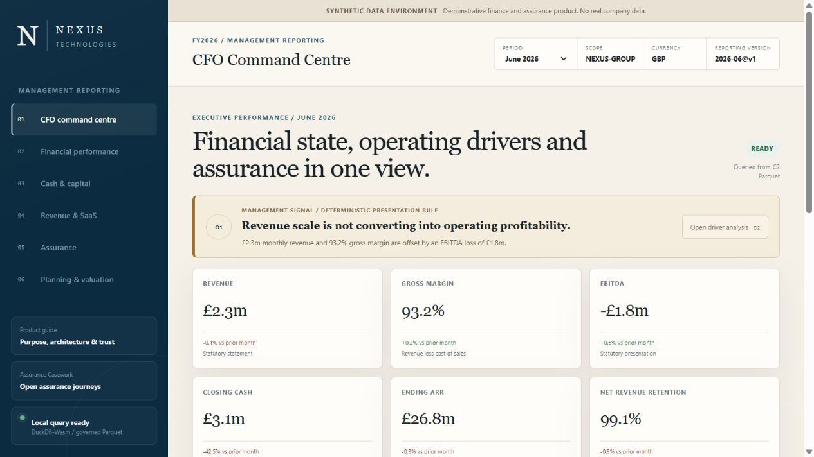
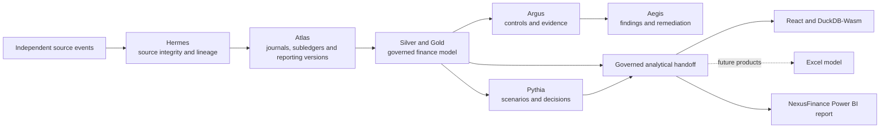
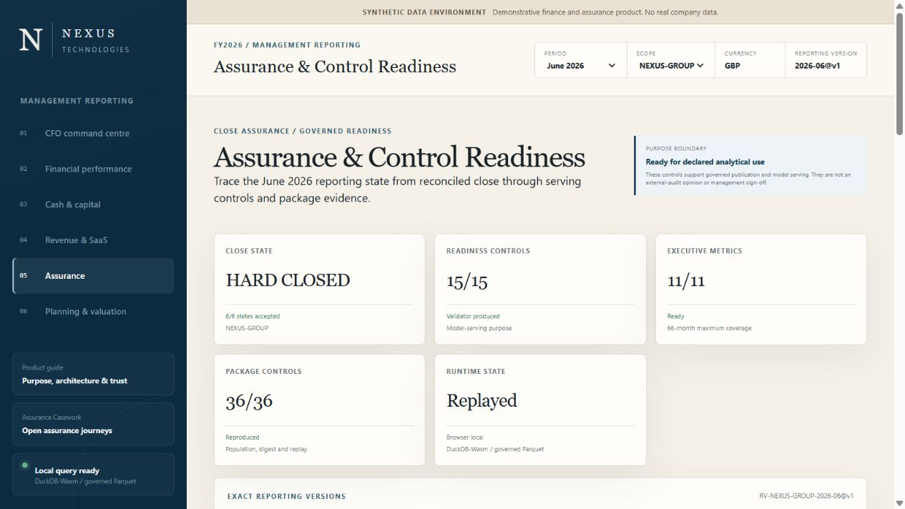
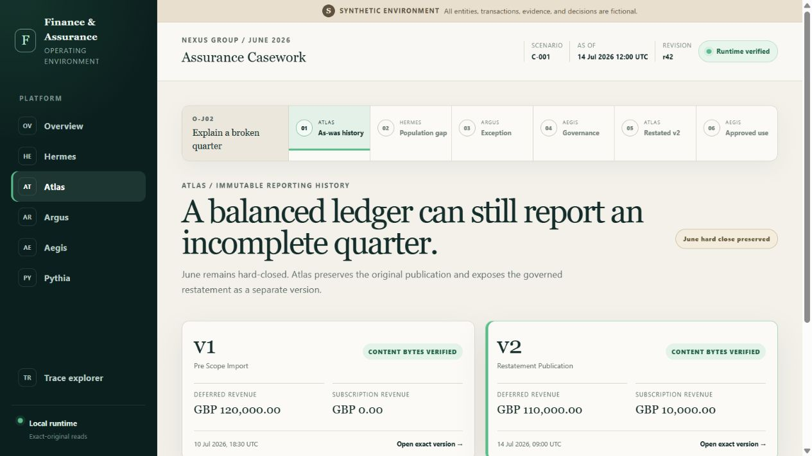

# Finance & Assurance Platform

A synthetic company's finance function, built end to end, so the whole chain an
auditor tests can be seen at once: source systems that disagree, transactions
that arrive twice or arrive late, the journals derived from them, the period
close, the controls, the evidence, and the decisions management takes from the
result.

I built it because a junior auditor sees a narrow slice - a sample of 25 items,
one reconciliation, one control walkthrough - and rarely the system those slices
came out of. This is that system, with every defect placed deliberately so its
effect can be followed all the way downstream.

**Release target:** `v0.1 - Governed Finance Platform + React Intelligence Product`

> All entities, transactions and results are fictional. The repository is a
> portfolio and engineering demonstration; it is not an audit opinion,
> investment recommendation or production accounting system.



## What it is, in familiar terms

The five module names are internal shorthand. In the language of the work, they
model problems most finance and audit people meet every year:

| Familiar problem | Where it lives here |
|---|---|
| Completeness and accuracy of system-generated data | 78 source datasets and 4.2m rows carrying planted duplicates, late arrivals and reconciliation breaks, with source identity and lineage fixed on ingestion (Hermes) |
| The audit trail from transaction to financial statement | Every journal derived from a business event by versioned posting rules, through subledgers, to 66 months of reconciled income statement, balance sheet and cash flow (Atlas) |
| Immutability and period close | Posted journal headers and lines cannot be altered, and a hard-closed period cannot be silently reopened to fix history (Atlas) |
| Correction against prior period adjustment | Reversal runs through an open correction path; restatement republishes a reporting version while the original reporting state stays intact. The two are deliberately not the same mechanism (Atlas) |
| Controls testing and exception follow-up | 64 independent finance controls executed over the governed data, each producing retained evidence rather than a pass mark (Argus) |
| Findings, management letter points and remediation | Exception, finding, issue, remediation, readiness and sign-off are separate states with a journey between them, not one status field (Aegis) |
| The forward view behind a going concern or sustainability judgement | Scenario, liquidity and valuation-readiness runs over governed actuals, 360 scenario-months, sealed so a published figure cannot drift (Pythia) |
| Management information you can actually rely on | 99 governed datasets, 189 measure specifications and 387 automated tests, so a number on screen traces back to a rule version and a source row |

The point of separating these is that most reporting problems are not arithmetic
errors. They are a number that is correct in one layer and wrong in another, and
nobody can say which layer owns it. Here each layer owns its own truth and has to
reconcile to the next one.

## Where to look first

- **Want to see what a user gets?** The product views below, or run it locally
  with the quick start. Six management screens over browser-local data.
- **Care about data quality and reconciliation?** Start with the architecture
  note, then the source and Bronze layer.
- **Care about close, reversal and restatement?** The Assurance Casework view
  walks the immutable reporting history and a governed restatement.
- **Want to know whether it genuinely works?** The validation commands run the
  same gates CI runs on every push, including 387 data tests.

## Engineering inventory

- realistic multi-system finance event generation with defects, duplicates and late-arriving records;
- immutable Bronze ingestion and source identity through Hermes;
- rules-driven double-entry accounting, subledgers and reporting versions in Atlas;
- 66 months of reconciled income statement, balance-sheet and cash-flow history;
- fixed assets, banking, debt, leases, tax, equity, intercompany, procurement, billing, workforce and SaaS operating depth;
- typed Silver models and governed Gold facts, dimensions and executive marts;
- Argus control execution and Aegis evidence, finding and remediation journeys;
- governed Pythia scenario, liquidity and valuation-readiness outputs; and
- a serverless React product querying authenticated Parquet locally with DuckDB-Wasm.

## Architecture



The platform keeps business-event truth, source-system truth, accounting truth
and governed truth distinct. Only business events may drive posting rules;
accounting lifecycle events never re-enter the posting engine.

[Architecture and module ownership](docs/public-release/architecture.md) ·
[Artifact policy](docs/public-release/artifact-policy.md) ·
[Reproducibility](docs/public-release/reproducibility.md)

## v0.1 product surface

The React product contains six finite management experiences and a product guide:

1. CFO command centre
2. Financial performance
3. Cash and capital
4. Revenue and SaaS economics
5. Assurance and control readiness
6. Planning and valuation

The interface calculates no alternative accounting or DCF authority. Actuals
come from Atlas reporting versions; planning results come from sealed Pythia
model runs; each downloaded Parquet partition is authenticated before local
DuckDB registration.

## Product views

### CFO command centre


### Assurance and control readiness



### Assurance Casework



## Scale and governed state

| Layer | v0.1 position |
|---|---:|
| Source and Bronze datasets | 78 |
| Source/Bronze rows | 4,227,015 |
| Historical periods | 66 months |
| Typed Silver views | 70 |
| Governed Gold datasets | 99 |
| Governed relationships | 187 |
| Governed measure specifications | 189 |
| dbt tests | 387 |
| Independent finance controls | 64 |
| React runtime Parquet partitions | 114 |
| Pythia forecast results | 360 scenario-months |

## Quick start

Prerequisites:

- Python 3.13
- [uv](https://docs.astral.sh/uv/) 0.11.32
- Node.js 22.13 or newer

Install the locked Python environment:

```bash
uv sync --locked --dev
```

Start the complete local product, including the finite assurance API and React application:

```bash
uv run --locked python public_product.py serve
```

Open `http://127.0.0.1:3000`.

For the finance-intelligence frontend only (the Assurance Casework routes require
the complete launcher above):

```bash
cd web
npm ci
npm run dev
```

The repository includes the compact, governed v0.1 browser dataset. The pinned
DuckDB-Wasm module is prepared from `node_modules`; no hosted database, API key
or external company dataset is required.

## Validation

```bash
uv run ruff check .
uv run pytest -q
uv run python scripts/check_public_release.py

cd web
npm ci
npm run lint
npm run typecheck
npm run test:finance
npm test
```

GitHub Actions executes the same Python, public-hygiene and web gates on every
push and pull request.

## Repository map

```text
src/finance_assurance/   Python domain, runtime, generators and services
models/                  dbt Silver, Gold and governance models
macros/                  dbt macros
tests/                   Python, SQL and contract tests
web/                     React/vinext finance product
consumer-products/       Excel and Power BI product workspaces
docs/architecture/       Ratified architecture contracts and ADR log
docs/product/            Product and analytical contracts
docs/roadmap/            Implemented milestone records
docs/public-release/     Public architecture, artifacts and reproduction guide
scripts/                 Release and supporting build utilities
```

The roadmap is intentionally append-only. Its [index](docs/roadmap/README.md)
distinguishes current release work from retained correction and reassessment
evidence.

Generated warehouses, complete source populations, local Excel/PBIX files and
temporary evidence do not belong in source control. See the
[artifact policy](docs/public-release/artifact-policy.md).

## Roadmap

- `v0.1`: governed finance platform and React intelligence product
- `v0.2`: integrated Excel three-statement and DCF model
- `v0.3`: [NexusFinance Power BI report and semantic model](consumer-products/power-bi/README.md)
- `v1.0`: complete cross-product portfolio release

## Project status and use

The v0.1 implementation is deterministic and extensively tested, but remains a
synthetic portfolio environment rather than production software. External
contributions are not currently accepted; responsible security reports are
welcome through GitHub's private reporting channel.

Released under the [MIT License](LICENSE). See the
[portfolio and data disclaimer](DISCLAIMER.md) for the synthetic-use boundary.
