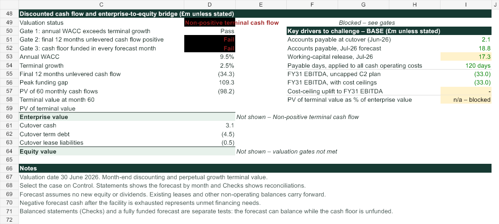

# Excel Product Workspace

## Review model

`Nexus-Financial-Model.xlsx` is the completed and reviewed Nexus Group workbook.
It integrates all three statements, scenario drivers and a DCF over one exact
C2 delivery package. The model uses 66 months of governed actuals and projects
60 monthly periods from July 2026. The XLSX is held in the local authoring
workspace. [Model specification and rebuild command](specifications/v0.2-model.md)

In the preview, the base-case DCF withholds enterprise and equity values because
terminal free cash flow is non-positive and the cash floor is unfunded. The
workbook's Checks tab tests statement reconciliation separately.
[Validation notes](validation/README.md)

## Working boundary

- Keep model design, schedules, named-range conventions, input maps and
  validation specifications in this tracked directory.
- Keep evolving `.xlsx` files, linked copies of delivery data and rendered
  review exports in `work/` or `exports/`; both are ignored.
- Publish a reviewed workbook as a tagged release asset with its input package
  reference, control totals and reconciliation statement.

The C2 data-only Excel inspection pack supports review of the governed facts,
relationships and measures that feed the workbook.

Tracked workbook specifications belong in `specifications/`; executable review
and reconciliation definitions belong in `validation/`. The private workbook
itself remains in `work/` until a reviewed release asset is published.
