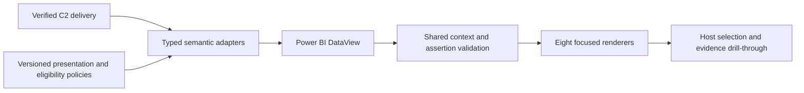

# Purposeful Power BI custom visuals v0.1

This design record reflects the baseline and input gates at 2026-11-08.
See the [current package inventory](README.md) and the
[comparison implementation](comparison/README.md) for the delivered visuals
and the supplemental inputs used for P7 and P8.

## 1. Product decision

Build a small library of reusable finance and assurance primitives. Each visual
must make its claim, scope, authority and evidence understandable together.
The differentiator is a decision backed by an explicit data contract, not an
unusual chart shape.

Start with P5 Reliability-Gated KPI Tile, P2 Rollforward Bridge, then P1 Statement
Matrix. Design the assertion contract with P2 so P3 can reuse it. Add P3 and the
Exception Register, then P4 Close Governance Grid. P6 can follow when lineage
navigation is useful. Full P7 and P8 demonstrations depend on additional data.

| Primitive | Reuse | Distinctive behaviour | Current data position |
| --- | --- | --- | --- |
| P1 Statement Matrix | Income statement, balance sheet, cash flow | Finance layout with line-level authority and evidence | Values available; presentation scaffold required |
| P2 Rollforward Bridge | Nine movement schedules | Closing anchor plus explicit arithmetic and source assertions | All nine formulas reconcile; wide-to-long adapters required |
| P3 Reconciliation Tie-Out Panel | C2 controls, C1 readiness, financial ties | Operands, operator, result and evidence in one claim | Available at different grains and assurance strengths |
| P4 Close Governance Grid | Period and reporting-scope review | Five distinct status dimensions and lifecycle event references | 198 published, hard-closed v1 records; failure fixtures required |
| P5 Reliability-Gated KPI Tile | All governed KPI pages | Purpose-specific eligibility, withheld value and reason | Values and readiness available; explicit eligibility policy required |
| P6 Lineage DAG | Shared data-product lineage page | Declared dependencies with honest evidence depth | 29 dataset descriptions; no row-level transaction graph in this metadata |
| P7 Two-Stage Variance Bridge | Department, account, scenario review | Budget to forecast to actual with economic favourability | Current periods support two anchors at a time; no three-anchor overlap |
| P8 Restatement Comparator | Reporting-version review | Preserved original, republication and attributed delta | Current delivery contains v1 only; version-pair dataset required |

The optional bullet chart stays outside the first delivery. Native visuals
remain appropriate for operational trends, aging, segment comparisons and most
overview pages. Do not claim that these chart categories are commercially novel.
The portfolio claim is the integration of accounting, governance and evidence.

Native Power BI already supports parentheses for negative numbers through format
strings. A DAX measure can also withhold a card value. P1 and P5 earn their cost
through consistent layout, policy, context and explanations. Do not justify them
with blanket claims that native formatting, sorting or gating is impossible.
[Microsoft custom format strings](https://learn.microsoft.com/en-us/power-bi/create-reports/desktop-custom-format-strings)
and [DAX BLANK](https://learn.microsoft.com/en-us/dax/blank-function-dax).

## 2. Inspected baseline and constraints

The source inspected for this design is
`build/finance-delivery/Q-FINANCE-C2-V1`, published as `Q-FINANCE-C2@v1`.
Its expected detached delivery digest is
`sha256:7538132e08ea2b7e8c20f339db10e6c138cd2a08c71c4708c47c378d7c1b0141`.
The A24 source package digest carried by mart rows is a different identity:
`sha256:39af66f379d5497399f89e3956e601b6fb99a070146d8c6d378bb684f288b7e5`.

The delivery has 21 marts and eight dimensions. The accepted PBIP currently
imports seven presentation tables. Availability in C2 does not imply an existing
Power BI relationship, measure or visual binding. New imports and adapters must
retain the pinned delivery and be reconciled before use.

| Inspected input | Observed facts | Design consequence |
| --- | --- | --- |
| `mart_cfo_presented_financials` | 8,514 rows; 10 income-statement, 27 balance-sheet and six cash-flow lines per period/scope | Amounts already have presentation signs. Income-statement `display_order` follows alphabetic account labels before net income, not an executive P&L layout. |
| `dim_reporting_version` | 198 rows, all `@v1` and `HARD_CLOSED` | No predecessor/version-chain edge or restatement case is supplied. |
| `mart_planning_performance_monthly` | 10,416 rows; 3,696 ACTUAL rows through June 2026; 6,720 FORECAST rows from July 2026 to June 2036 | ACTUAL rows have zero forecast and no forecast reference. FORECAST rows have zero actual and no budget-version reference. All rows have `is_statutory_actual = false`. |
| `metadata/reconciliation.json` | 36 PASS rows with `expected_value`, `actual_value`, `difference`, `status`, `evidence` | There is no `comparison_operator` or structured `evidence_digest` column here. Assertions differ in strength. |
| `mart_model_readiness_controls` | 15 PASS rows; 14 `EQUAL`, one `GREATER_THAN_OR_EQUAL` | These are delivery-wide controls, not monthly observations. Actual 66 versus required 60 is a valid pass. |
| `mart_cfo_metric_readiness` | 11 READY metrics, no `first_failure_reason` populated | Readiness covers a metric history. It is not automatically a per-row or per-period reliability verdict. |
| `metadata/lineage.json` | 29 rows of dataset/dependency descriptions | Dependencies are pipe-delimited; some source names are symbolic collections. |
| Exception hooks | Ghost headcount and balance-sheet differences are zero throughout; unapplied cash is nonzero in 130 balance-sheet rows; overdue AP bps is nonzero in 65 of 66 rows | Nonzero exposure is not itself a failed control. Do not describe the passing delivery as containing activated defects. |

All nine proposed rollforward equations were evaluated using integer arithmetic
against the delivered Parquet rows. All 5,304 schedule-row checks passed. This
is evidence of arithmetic closure, not proof of source completeness or an
independent bank/subledger reconciliation. Section 5 records the formulas.

The schema and source logic were checked in
[`models/gold/marts_c1`](../../../models/gold/marts_c1),
[`assert_b2_rollforwards.sql`](../../../tests/model/assert_b2_rollforwards.sql),
[`assert_b4_variance_source.sql`](../../../tests/model/assert_b4_variance_source.sql)
and the [C2 control producer](../../../src/finance_assurance/finance_delivery/service.py).

## 3. Shared architecture and capability contract

### Ownership

The semantic model owns financial calculations, applicability, aggregation,
eligibility and policy lookup. The visual owns layout, interaction, defensive
contract validation and a reproducible arithmetic cross-check of supplied
operands. A renderer cannot approve a close, create a finding, change readiness,
post a journal or mutate a reporting version.

Use separate TypeScript `.pbiviz` packages with shared, versioned source modules
for context, formatting, assertions and accessibility. Avoid a single visual
with eight unrelated modes. Ship prebound PBIR examples so users do not need to
populate every context field manually. HTML/CSS and SVG are implementation
choices inside each visual, not an arbitrary HTML measure interface.

### Role notation and mapping

The tables below specify intended `capabilities.json` roles. `G` means
`Grouping`, `M` means `Measure`, and `GM` means `GroupingOrMeasure`. `1` means
`min: 1, max: 1`; `0..1` means `min: 0, max: 1`. Counts are bound fields, not
data rows. State every role's bounds in mapping conditions, including optional
roles. Text measures must resolve a single value explicitly rather than selecting
an arbitrary first value. Use numeric required types for M roles and text types
for identifiers/statuses; order roles require integers.

The proposed mapping for each primitive is `table`, with `table.rows.select`
selecting its roles. That retains row identity and attached evidence before
rendering a matrix, bridge, grid or graph. The renderer sorts explicitly and
never trusts DataView arrival order. P1 pivots complete table rows into statement
columns; P6 converts an edge table to adjacency. A matrix mapping can be
reconsidered if hierarchical expansion becomes a requirement.
[Microsoft capabilities](https://learn.microsoft.com/en-us/power-bi/developer/visuals/capabilities)
and [DataView mappings](https://learn.microsoft.com/en-us/power-bi/developer/visuals/dataview-mappings).

All role names in this document are proposed visual API names. Source columns
are identified separately. An adapter-derived role is not a claim that the
column already exists in C2.

### Common roles C

Each visual includes these roles in addition to its own table. Where several
role names share a row below, each is a separate role with the stated bound.

| Role | Kind / bound | Contract |
| --- | --- | --- |
| `claimKey` | G / 1 | Stable identity at the rendered row grain; includes version and scenario where applicable. |
| `purpose`, `authority` | GM / 1 each | Declared claim purpose and value authority; raw values remain inspectable. |
| `deliveryRef`, `deliveryDigest` | GM / 1 each | Exact delivery identity imported from manifest/preflight context. |
| `sourceDigest` | GM / 0..1 | `source_package_digest` or exact manifest source binding; not a replacement for delivery identity. |
| `evidenceRef` | GM / 1 | Structured source record/relation/metadata pointer produced by the adapter. A relation pointer alone is labelled relation-level evidence. |
| `evidenceDigest` | GM / 0..1 | Supplied evidence-body hash with its type declared in the evidence view. Missing means unavailable. |
| `contextState` | GM / 1 | Adapter result: `VALID`, `MISSING`, `AMBIGUOUS` or `INCOMPLETE`. Visual validation can downgrade it, never silently upgrade it. |
| `expectedRowCount` | M / 0..1 | Exact expected row count after the supported selection, before display reduction; required for multirow claims. |

For metadata-only claims, the adapter names the authority as package metadata
and uses the actual file and row key as evidence. It does not fabricate a
statutory reliability status. Registry-derived labels are marked as such.

### Host capabilities and interactions

| Capability | Proposed behaviour |
| --- | --- |
| `privileges` | Empty array. No WebAccess, external fonts, remote assets, analytics calls or visual-managed storage. |
| `objects` | Versioned formatting groups: typography, units, spacing, labels and accessibility. Assertion thresholds, authority and eligibility cannot be overridden through formatting. |
| `supportsEmptyDataView` | Enabled; display a useful unbound/empty/blocked state. Clear previous values immediately on a context change. |
| `supportsKeyboardFocus` | Enabled with implemented focus order and keyboard interactions. |
| `tooltips` | Show supported host tooltips containing the same permitted context as the main view. |
| `sorting` | Custom ordering by declared row/step/period order; no automatic numeric sorting of statements or bridges. |
| `supportsHighlight` | False initially. Normal selections/filter updates are supported; partial highlights must not silently redefine an assertion. |
| Row reduction | Windowed delivery plus explicit segment handling. Fetch a complete supported selection, or show `INCOMPLETE`. No sampled/top-N data may prove a total. |
| Selection | Use host selection identities and context menu. Preserve the full version key for existing Reporting Version Evidence drill-through. Test each adapter's filter propagation. |

The capability properties expose host support; they do not implement the
interaction by themselves. Validate emitted capabilities against the pinned
Power BI API schema when implementation begins.

### Financial and evidence safeguards

- Keep amounts in integer minor units through calculations. Scale for display
  only. Reject unsafe JavaScript integers or unsafe intermediate sums rather
  than approximate an assertion; use an exact representation if future inputs
  exceed that range. Tolerance defaults to zero minor units for these schedules.
- Null, unavailable, not applicable and numeric zero are distinct states.
  Source placeholders become unavailable only under an explicit applicability
  rule; the raw source remains unchanged.
- Scope, period, currency, version and scenario form the claim identity. Do not
  sum Group with its entities, mix currencies, or sum versions. P1/P4 may show
  separate periods; P8 intentionally binds two explicitly named versions.
- Period-end balances do not add through time. Ratios, retention and distinct
  customer counts use governed measures at their supported grain. Multi-month
  bridges need a first opening, consecutive movements and last closing, not a
  sum of openings/closings. First release is single-period P2.
- Validate row uniqueness and expected members, not just a net difference. Two
  offsetting errors must remain visible. Partial segments, unexpected missing
  steps, duplicate keys and mixed context disable a green assertion.
- `evidence_digest` on presented financials is the source trial-balance digest.
  It is not a unique statement-line receipt. A source hash, an evidence hash,
  a table logical digest and a delivery seal remain separately labelled.
- Displaying a digest is not cryptographic verification. Existing delivery
  verification stays in preflight; the visual renders its declared context.
- `drill_through_relation` names a relation, sometimes multiple relations. It
  does not supply source transaction rows or automatically establish host
  drill-through relationships. Add an explicit evidence adapter/page where
  row-level evidence is required.
- Reliability gates also apply to tooltip, accessibility and export text.
  Prefer a model measure that returns BLANK when a value is withheld, so the
  renderer never receives the raw value. This is a usage policy, not access
  security; RLS/OLS remain semantic-model responsibilities.

## 4. P5 Reliability-Gated KPI Tile

### Experience

Answer: "Can I use this metric for this decision, and under what authority?"
An eligible tile shows value, unit, period, purpose, authority and a short
eligibility label. A withheld tile shows the reason and authority in place of
the value. It must not show a stale prior value, a misleading zero or a green
status inferred from a string prefix.

Use `ELIGIBLE`, `WITHHELD`, `UNASSESSED`, `INVALID_CONTEXT` and `NO_DATA` as
presentation states. These are adapter states, not new platform readiness
states. The visible label should be "Eligible for [purpose]", not a universal
"Reliable" stamp.

| Role beyond C | Kind / bound | Source or adapter rule |
| --- | --- | --- |
| `metricId`, `metricLabel` | G / 1 each | Governed metric registry and source identifier. |
| `displayValue` | M / 1 | Explicit measure, BLANK unless eligible. |
| `unit` | GM / 1 | Currency minor/count/bps or another registered unit. |
| `period`, `scope`, `version` | GM / 1 each | Exact metric context; version must match the source value, not a guessed Group version. |
| `selectedPurpose` | GM / 1 | The intended use selected by report design or a single-valued purpose slicer. |
| `reliabilityStatus`, `reliabilityPurpose` | GM / 1 each | Unmodified source descriptors. |
| `eligibilityState`, `policyVersion` | GM / 1 each | Result and version of the explicit eligibility policy. |
| `readinessStatus`, `failureReason` | GM / 0..1 each | Applicable readiness result and explanation; explanation required when withheld/unassessed. |

Mapping: one complete table row, C plus the roles above. Multiple metric or
context rows produce `INVALID_CONTEXT`, not automatic aggregation.

### Policy and data work

Create a reviewable registry keyed by metric, intended purpose, source authority
and policy version. It declares accepted source reliability tuples, readiness
requirements, aggregation, version/scope mapping and permitted periods. Never
use `status.startsWith("RELIABLE")` as policy.

Source purpose and assessment purpose are different. For example,
`CFO_METRIC_READINESS` describes the readiness dataset; it is not the required
purpose for every metric it assesses. Join by a controlled metric map and check
its `first_period`/`last_period`, coverage and null criteria. A missing assessment
blocks metrics for which that policy requires assessment. Metrics outside the
11 assessed identifiers require their own declared policy.

The operating-metric CAPEX row illustrates why this matters: Group presentation
does not imply a Group reporting-version reference for every underlying metric.
Retain its actual source version and explain its scope mapping. Mixed-authority
command-center values must resolve authority per metric.

First delivery uses REVENUE, CLOSING_CASH and ENDING_ARR to exercise different
authorities. Accept one passed case, one withheld case, one purpose mismatch,
one missing assessment and one ambiguous selection. Label failing fixtures as
test data and keep them outside the sealed C2 delivery.

## 5. P2 Rollforward Bridge

### Experience and roles

Show an opening anchor, ordered signed movements, optional intermediate
subtotals and the independent closing anchor. Connectors explain accumulation.
Keep arithmetic closure, supplied source status and evidence coverage visible
as separate assertions. Label a computed result "Arithmetic tie-out"; reserve
"Independent reconciliation" for a contract with genuinely independent inputs.

| Role beyond C | Kind / bound | Source or adapter rule |
| --- | --- | --- |
| `bridgeKey`, `stepKey`, `stepLabel` | G / 1 each | One schedule and stable step identities. |
| `stepOrder`, `stepKind` | G / 1 each | Integer order; `OPENING`, `MOVEMENT`, `SUBTOTAL`, `CLOSING`. |
| `amountMinor` | M / 1 | Signed delta for movements, absolute supplied value for anchors. |
| `period`, `scope`, `version`, `currency` | GM / 1 each | Exact schedule context, resolved from its supported grain. |
| `sourceDifferenceMinor` | M / 0..1 | Supplied difference where present; never synthesise then label as source-provided. |
| `sourceStatus` | GM / 0..1 | Existing reconciliation status, with its actual scope. |
| `toleranceMinor` | M / 1 | Versioned policy, zero for the nine current formulas. |
| `assertionPolicyRef` | GM / 1 | Names the equation, sign treatment, tolerance and component coverage. |
| `failedComponentCount` | M / 1 | Adapter count before aggregation, preserving offsetting breaks. |

Mapping: ordered table for one bridge. Expected step count comes through C.
Subtotals display a running-state checkpoint; they are never added as another
movement. The final bar remains the published closing, even when the bridge
does not close. Show the break separately; do not manufacture a balancing plug.

### Nine source mappings

Every equation below calculates `difference = expected closing - supplied
closing`. Field names are exact. Normalize decreases once in the adapter.

| Schedule and source mart | Expected closing formula | Closing field | Supplied assertion / inspected rows |
| --- | --- | --- | --- |
| Debt: `mart_capital_structure_monthly` | `opening_debt_minor + debt_drawdown_minor - debt_repayment_minor` | `closing_debt_minor` | No difference column; 132 rows |
| Lease: `mart_capital_structure_monthly` | `opening_lease_liability_minor + lease_addition_minor + lease_interest_minor - lease_cash_payment_minor` | `closing_lease_liability_minor` | No difference column; 132 rows |
| Gross assets: `mart_fixed_asset_capex_monthly` | `opening_gross_book_value_minor + capex_additions_minor - gross_disposals_minor` | `closing_gross_book_value_minor` | No difference column; 330 rows |
| Accumulated depreciation: `mart_fixed_asset_capex_monthly` | `opening_accumulated_depreciation_minor + depreciation_minor + amortisation_minor + impairment_minor - accumulated_depreciation_disposal_minor` | `closing_accumulated_depreciation_minor` | No difference column; 330 rows |
| Deferred revenue: `mart_revenue_waterfall_monthly` | `opening_deferred_revenue_minor + new_billings_minor - recognised_revenue_minor` | `closing_deferred_revenue_minor` | `rollforward_difference_minor`; 66 rows |
| Tax payable: `mart_tax_equity_monthly` | `opening_tax_payable_minor + current_tax_expense_minor - cash_tax_paid_minor` | `closing_tax_payable_minor` | `reconciliation_status` is supplied, no difference column; 198 rows |
| Retained earnings: `mart_tax_equity_monthly` | `opening_retained_earnings_minor + net_income_minor - dividends_minor + other_equity_movements_minor` | `closing_retained_earnings_minor` | `reconciliation_status`, no difference column; 198 rows |
| Cash: `mart_cash_flow_liquidity_monthly` | `opening_cash_minor + operating_cash_flow_minor + investing_cash_flow_minor + financing_cash_flow_minor + fx_and_other_movement_minor` | `closing_cash_minor` | `unreconciled_difference_minor` and `reconciliation_status`; 198 rows |
| MRR: `mart_saas_performance_monthly` | `beginning_mrr_minor + new_mrr_minor + expansion_mrr_minor + contraction_mrr_minor + churn_mrr_minor + fx_remeasurement_mrr_minor` | `ending_mrr_minor` | No difference column; 3,720 rows |

Cash's supplied unreconciled difference is a separate source assertion; do not
assume its definition is the displayed component equation. Revenue's
`schedule_difference_minor` compares recognised revenue with scheduled revenue,
so show it as a second assertion, not as the rollforward difference.

Lease may alternatively use additions minus principal reduction. Do not combine
principal reduction with interest and cash payment in one equation. MRR
contraction/churn/FX are already signed; no second sign flip. Accumulated
depreciation increasing is not automatically an adverse business outcome.

Initial grains are one period/scope/currency/version for capital, tax and cash;
one entity/asset class for fixed assets; Group for revenue; and one supported
product/region/segment selection for MRR. Aggregated schedules require component
coverage and failed-component count as well as a net tie-out.

First delivery proves cash, deferred revenue and signed MRR, then binds the
remaining six uses to the same renderer. Acceptance includes one-minor-unit
breaks, missing movements, duplicate rows, offsetting errors, subtotal handling
and supplied-status disagreement. All nine adapters must pass before claiming
nine-section coverage.

## 6. P1 Statement Matrix

### Experience and roles

Display finance statements with deliberate order, section labels, spacers,
indentation, subtotal/total rules and aligned comparative columns. Parenthesis
negatives, zero treatment, precision and unit labels are formatting decisions.
Every monetary cell retains its reporting-version and evidence identity.

| Role beyond C | Kind / bound | Source or adapter rule |
| --- | --- | --- |
| `rowKey`, `rowLabel` | G / 1 each | Source metric identity or explicitly structural scaffold row. |
| `rowOrder`, `rowKind`, `indentLevel`, `ruleStyle` | G / 1 each | Proposed versioned presentation scaffold. `ruleStyle` is none/single/double, not raw CSS. |
| `columnKey`, `columnLabel`, `columnOrder` | G / 1 each | Supported period/comparison definition. |
| `amountMinor` | M / 1 | `presented_amount_minor` or an explicitly registered derived subtotal; null on structural rows. |
| `statementClass`, `period`, `scope`, `version`, `currency` | GM / 1 each | Exact context for that cell. |
| `signConvention` | GM / 1 | Source `sign_convention`; metadata for interpretation, not an instruction to flip a second time. |
| `presentationPolicyRef` | GM / 1 | Layout version and any registered line formulas. |
| `lineEligibility`, `lineFailureReason` | GM / 1, GM / 0..1 | Per-cell purpose gate and explanation when blocked. |

Mapping: complete table of row-by-column cells. Pivot only after checking
uniqueness at row/column/version. Sort by scaffold order with stable key
tie-breaks; duplicate orders requiring ambiguity resolution are invalid.
The common claim key identifies the cell, not just the visible label.

### Presentation adapter

Keep source `display_order` and source amounts for audit. Add an explicit
presentation registry keyed by statement class and metric ID. It places revenue
before expenses, preserves supplied totals and declares spacer/header rows.
It can add a subtotal only with an approved formula and derivation label. It
must not silently turn the existing six-line cash-flow summary into a complete
statutory cash-flow statement, or claim EBITDA exists in this source mart.

`presented_amount_minor` is already signed according to statement class. An
expense is not negated again. Balance-sheet contra-assets must retain their
actual source sign; the label `POSITIVE_PRESENTED_BALANCE` is not permission
to take absolute values.

Never sum all displayed rows: supplied totals overlap their components.
Structural rows have no financial selection identity. A derived subtotal uses
its own evidence definition, not a copied hash pretending to prove the formula.
Income and cash-flow measures may aggregate over an approved period window;
balance-sheet columns use the closing snapshot. Start with month and prior
month. Add YTD/LTM only as explicit semantic measures with version-set evidence.

Acceptance covers all three statements, exact source-value reconciliation,
negative/zero/null formatting, totals without double counting, unsupported
comparisons, line-level gating, evidence navigation and narrow/wide layouts.

## 7. P3 Reconciliation Tie-Out Panel

Render `actual [operator] expected`, the diagnostic difference, published
result, replay result and evidence. Distinguish `ARITHMETIC`, `THRESHOLD`,
`INDEPENDENT_RECONCILIATION`, `DELIVERY_PARITY` and `SOURCE_BINDING` claim types.
These are presentation classifications, not substitutes for control authority.

| Role beyond C | Kind / bound | Source or adapter rule |
| --- | --- | --- |
| `assertionId`, `assertionLabel`, `assertionType` | G / 1 each | Namespaced control ID and explicit claim classification. |
| `actualValue`, `expectedValue` | M / 1 each | Supplied typed operands, with no implicit aggregation. |
| `operator`, `unit` | GM / 1 each | Registered comparator and common unit. |
| `publishedResult`, `assertionPolicyRef` | GM / 1 each | Source outcome and exact rule/version binding. |
| `sourceDifference` | M / 0..1 | Optional published diagnostic; default replay diagnostic is actual minus expected. |
| `actualEvidenceRef`, `expectedEvidenceRef` | GM / 0..1 each | Both mandatory to claim independent-source reconciliation. |
| `period`, `scope`, `version` | GM / 0..1 each | Required for financial-row assertions; absent for delivery-wide controls. |
| `failureRef` | GM / 0..1 | `first_failure_ref`, where present. |

Mapping: one assertion per table row, C plus these roles. Operators initially
support `EQUAL` and `GREATER_THAN_OR_EQUAL`; unknown operators are `UNASSESSED`.
Never infer failure from a nonzero difference when the operator is a threshold.
Missing operands are unassessed, not zero. A source PASS and failed replay show
an explicit disagreement; neither overwrites the other.

Normalize C2 `status` and C1 `result_status`. For the current C2 producer,
equality is an adapter declaration tied to its contract/source version; it is
not a column in `reconciliation.json`. Preserve the full evidence text. C1
provides `comparison_operator`, `evidence_relation` and `validator_ref`; it does
not provide two independent operand digests by default.

Some C2 rows check availability/binding, not detailed reconciliation. In
particular, the delivered C2 tax/equity evidence says the mart is present and
source-bound. Show that limited claim. Do not present all 36 PASS results as
36 independently replayed accounting reconciliations. The panel can separately
run the explicit tax and retained-earnings equations through their adapter.

Keep the 36 C2 assertions and 15 C1 readiness controls distinguishable by source
and grain. They are not 51 independent certifications. Month slicers must not
relabel package-wide results as selected-month results.

## 8. P4 Close Governance Grid

Rows are periods, columns are reporting scopes. Each cell contains five labelled
status markers plus close state, publication identity and close timestamp.
Select a cell for event references and reporting-version evidence. This is a
read-only review surface; the platform cockpit retains close decision authority.

| Role beyond C | Kind / bound | Source or adapter rule |
| --- | --- | --- |
| `period`, `scope`, `scopeType`, `version` | G / 1 each | `dim_reporting_version` identities. |
| `subledgerStatus` | GM / 1 | `subledger_reconciliation_status`. |
| `bankStatus` | GM / 1 | `bank_reconciliation_status`. |
| `intercompanyStatus` | GM / 1 | `intercompany_reconciliation_status`. |
| `trialBalanceStatus`, `statementStatus` | GM / 1 each | `trial_balance_status`, `statement_status`. |
| `closeStatus`, `closedAt` | GM / 1 each | `close_status`, `closed_at`; show the display timezone. |
| `softCloseEvent`, `hardCloseEvent`, `publicationEvent` | GM / 0..1 each | The three supplied accounting-event refs; values required when the selected lifecycle state requires them. |

Mapping: table, one selected version per period/scope. A second version never
replaces the first silently; require a version filter or explicit version lane.
Do not calculate "percent complete" by counting green markers.

Use a status dictionary per dimension. The current bank values include
`RECONCILED`, `CONSOLIDATED` and `NOT_APPLICABLE`; intercompany includes
`CONFIRMED` and `NOT_APPLICABLE`. Neither N/A nor consolidated is a failed bank
reconciliation. Unknown values remain visible and unclassified. Missing or
contradictory required event references flag incomplete governance evidence.

All 198 current rows are hard-closed and published. Soft-close, blocked, stale
and republished examples require separate labelled fixtures. No reviewer
sign-off identity is present in this dimension; do not invent one from close
status or publication. Group and entity columns remain distinct scopes.

## 9. P6 Lineage DAG

Begin with dataset lineage: direct dependency to gold mart, with transformation
class and declared A24 sources in the detail view. Offer search, selected-node
neighbourhood and an accessible edge list. Do not draw an invented transaction
to journal to finding chain from table metadata.

| Role beyond C | Kind / bound | Source or adapter rule |
| --- | --- | --- |
| `edgeId`, `fromNodeId`, `toNodeId` | G / 1 each | Stable deduplicated edges from `direct_dependencies` to `gold_model`. |
| `fromLabel`, `toLabel`, `fromKind`, `toKind` | G / 1 each | Resolved dataset or explicitly unresolved dependency labels. |
| `edgeKind`, `transformationClass` | GM / 1 each | Declared dependency and source `transformation_class`. |
| `datasetId`, `declaredBronzeSources` | GM / 1 each | `dataset_id` and preserved `a24_bronze_sources`. |
| `evidenceDepth` | GM / 1 | Initially `DATASET_DEPENDENCY`; row-level depth requires a different authoritative edge feed. |

Mapping: edge table. Split pipe-delimited dependencies and deduplicate exact
edges. Do not cross-product bronze sources with direct dependencies: the file
does not specify those individual edges. Symbolic collections such as
`C1_MARTS` and `MULTIPLE_GOVERNED_A24_SOURCES` remain marked collections, not
resolved physical tables. Missing upstream metadata creates a boundary node.

Validate self-edges, cycles, duplicate identities and incomplete edge delivery.
A cycle is a metadata error for this DAG view, not an excuse to drop an edge.
Lineage navigation does not certify values and must not imply that relation
pointers contain transaction-level proof. Use host navigation to known evidence
pages, with no renderer network request to resolve a node.

## 10. P7 Two-Stage Variance Bridge

The intended journey is budget anchor, forecast adjustments, forecast anchor,
actual adjustments, actual anchor. Both segments reconcile separately. The
same forecast anchor is not counted twice. Economic favourability is distinct
from the movement sign and is evaluated for the specific metric.

| Role beyond C | Kind / bound | Source or adapter rule |
| --- | --- | --- |
| `bridgeKey`, `driverKey`, `driverLabel`, `stage`, `driverOrder` | G / 1 each | Aligned grain; stage is budget-to-forecast or forecast-to-actual. |
| `signedDeltaMinor` | M / 1 | Registered segment contribution derived from supplied amounts. |
| `budgetMinor`, `forecastMinor`, `actualMinor` | M / 1 each | Anchors at the same selected period and grain; values may be unavailable. |
| `period`, `currency`, `scenario`, `coverageState` | GM / 1 each | Exact selected horizon/scenario and applicability result. |
| `budgetVersion`, `forecastVersion`, `actualAuthorityRef` | GM / 1 each | Required identity for each available anchor; no fabricated refs. |
| `statementLine`, `favourabilityPolicyRef`, `favourability` | GM / 1 each | Governed economic direction, not a class-level colour guess. |

Mapping: table by driver/stage. Preserve department/account/line/scenario
identity in `claimKey`. Repeated anchor measures are checked for consistency,
not summed. Validate complete driver coverage for each segment.

Current data does not support the full journey. Historical rows have budget
and management-source actual, but no forecast. Future rows have forecast and
a budget comparator without `budget_version_ref`; that comparator must be
labelled source-reported, not an approved budget version. Placeholder zero
actual/forecast and their mechanically computed variances must not be plotted
as real economic movements.

Offer a clearly labelled two-anchor mode only where its operand authorities
are known. Full mode requires co-temporal budget, forecast and actual values,
their version/source bindings and an alignment policy. Current actuals are
`MANAGEMENT_SOURCE_REPORT`, not statutory actuals. Do not silently substitute
statutory P&L values or claim the two authorities reconcile.

All 10,416 rows have `statement_class = INCOME_STATEMENT`; that field cannot
distinguish revenue from cost favourability. A versioned account/statement-line
policy must define cost/revenue semantics and signed versus positive-cost
representation. Unknown metrics use neutral colours. Reuse P2 geometry and
assertion logic after the data gate is met.

## 11. P8 Restatement Comparator

Compare the same period, scope, currency and statement definition under two
immutable reporting versions. Show original, republished value, delta and
republication/case evidence. Preserve the original publication and close
context. An unexplained delta remains unexplained.

| Role beyond C | Kind / bound | Source or adapter rule |
| --- | --- | --- |
| `lineKey`, `lineLabel`, `lineOrder`, `linePresence` | G / 1 each | Full outer alignment; both, added or removed line. |
| `originalValueMinor`, `revisedValueMinor`, `deltaMinor` | M / 1 each | Supplied immutable statement snapshots and a checked revised-minus-original delta. |
| `period`, `scope`, `currency`, `statementClass` | GM / 1 each | Must agree for comparison. |
| `originalVersion`, `revisedVersion`, `predecessorVersion` | GM / 1 each | Explicit version relationship, not version suffix sorting. |
| `republicationEvent`, `restatementCase` | GM / 1 each | Governed publication/case binding. |
| `originalEvidenceRef`, `revisedEvidenceRef`, `adjustmentEvidenceRef` | GM / 1 each | Separate provenance for both values and the explanation. |
| `originalDeliveryRef`, `revisedDeliveryRef` | GM / 1 each | Preserve each package identity when versions arrive in separate deliveries. |
| `originalDeliveryDigest`, `revisedDeliveryDigest` | GM / 1 each | Independently verified delivery bindings. |

Mapping: table by aligned statement line. Common delivery context describes
the comparison adapter; it never replaces either input's identity. Added or
removed lines are explicit. Missing is not automatically zero: delta treatment
requires a registered line-presence policy and complete snapshots.

`dim_reporting_version` has only `@v1` references and lacks a predecessor or
restatement-case field. Neither the dimension nor the marts supply v2. The
current output must be "Comparison unavailable: one reporting version".

The enabling dataset must contain both statement snapshots, predecessor edge,
restatement case, correction/presentation-adjustment evidence and republication
event. Attribute a line delta only when that evidence supports it. A publication
event proves republication; it does not alone explain the amount of every line.
Use the C-001 runtime proof for a separately labelled adapter fixture, then a
new governed delivery for a production demonstration. Never edit C2 v1 to
pretend it originally contained v2.

## 12. Native pages and the Exception Register

| Page | Recommended treatment |
| --- | --- |
| Command centre | Native layout with P5 tiles, explicit period and authority, then targeted drill-through. |
| Liquidity | Native cash/debt/facility trends plus P2 cash. Call it liquidity capacity until a burn/forecast methodology supports a runway calculation. |
| Cash conversion | DSO, DPO and collections at their governed grain. A full cash-conversion cycle needs inventory days or an explicit service-business definition. |
| SaaS | Native retention by product/region/segment plus P2 MRR. This is segment retention; true cohorts need customer/subscription cohort vintage and elapsed-period data. |
| Capex and workforce | Native asset-class and department analysis; P2 schedules where useful. Separate period-end headcount/FTE from additive payroll cost. |
| AR/AP | Native overdue balances and ratios. Full aging buckets need invoice/due-date or prebucketed data, beyond overdue totals alone. |
| Tax | Native tax/loss-utilisation analysis; effective rate uses a governed profit denominator and handles zero/negative profit explicitly. |
| Close assurance | P4 grid, P3 assertions and existing version-evidence drill-through. |
| Exception Register | Native register plus P3 detail and P5 affected-metric eligibility. |

The Exception Register needs a normalized observation adapter, not an unpivot
of every nonzero numeric field. Minimum fields are observation ID, rule/version,
source relation/row, period/scope/version or delivery scope, metric, observed
value, unit, operator, expected value/threshold, machine result, evidence refs,
affected metric/purpose and explicit links to reviewed governance objects.

| Hook | Initial treatment |
| --- | --- |
| Rollforward, schedule, balance-sheet and cash differences | Equality controls at the appropriate source grain, normally zero minor units. Preserve component failures even if aggregate differences cancel. |
| `ghost_headcount_count` | Use its existing control definition and evidence. Current delivered values are zero; an activated failure needs a labelled fixture or new delivery. |
| `not_ready_metric_count`, `first_failure_reason` | Readiness signal at its published scope; avoid attaching a package-wide result to every month. |
| `unapplied_cash_minor`, `overdue_ap_bps` | Risk/exposure indicators. A failed-control label needs a named, versioned threshold and applicable purpose. No invented universal tolerance. |

A machine exception can link to a finding, issue, remediation, readiness
assessment and decision if those records are actually supplied. Keep their
identities and statuses separate. An empty register is a legitimate passing
state. Display counts by object class, not a single combined "issue count".
Promoting an exception or approving a close belongs in the governed platform
workflow; a report selection does not perform that transition.

## 13. Visual quality, deployment and acceptance

### Design system

Use restrained typography, tabular numerals, consistent GBP/unit notation,
aligned decimal columns, deliberate whitespace and quiet structural rules.
Reserve red for a failed assertion or policy-defined adverse movement; missing
assessment has a distinct labelled state. Every state has text/icon support,
not colour alone. Support high contrast, keyboard access, readable focus,
responsive layouts and reduced motion. Evidence details are available on
selection without overwhelming the executive view.

P1 and P7 are established commercial visual categories. Judge them on finance
quality and transparent contracts. The strongest portfolio demonstrations are
P5 purpose gating, P2 asserted closure, P4 governed close evidence and P8
preserved reporting history once its data is available.

### Certification and export boundary

Pure local rendering is the design target. Use safe DOM text insertion and
reviewable bundled dependencies; do not interpret input as HTML or script.
Network-free implementation is one requirement, not certification. Microsoft
also requires review, testing, packaging and Partner Center approval. A future
certification submission needs an isolated single-visual review repository and
matching source/package; the development monorepo is not itself that submission.
[Microsoft certification requirements](https://learn.microsoft.com/en-us/power-bi/developer/visuals/power-bi-custom-visuals-certified).

Treat local packages as uncertified until approval exists. Tenant policy may
block them. Test Desktop and Service separately, and record PDF, PowerPoint
and subscription results for the chosen deployment path. Do not promise that
an uncertified screenshot or Desktop pass establishes export support. Retain
an export-friendly native/semantic fallback for critical board-pack claims.
[Microsoft visual tenant settings](https://learn.microsoft.com/en-us/fabric/admin/service-admin-portal-power-bi-visuals).

### Architecture checks against C-001 and CT-1

These are design-level checks, not a claim that the visuals have executed the
runtime scenarios. The canonical proofs remain
[C-001](../../../docs/product/canonical-transaction-c001.md),
[CT-1](../../../docs/product/canonical-transaction-ct1.md) and the
[accounting object model](../../../docs/architecture/accounting-object-model.md).

| Primitive | C-001 restatement check | CT-1 reversal check |
| --- | --- | --- |
| P5 | Gate each reporting version for its stated purpose; remediation does not retroactively rewrite v1 eligibility. | An open correction is not automatically hard-closed actuals or resolved readiness. |
| P2 | Original and revised bridges remain separately identified; no balancing plug hides omitted recognition. | Equal-and-opposite reversal and replacement stay separate signed movements when supplied; never net away their evidence. |
| P1 | Preserve each published statement and its evidence; v2 is an explicit comparison. | Show journal effects only in their authorized accounting/reporting context. |
| P3 | Missing expected recognition can be a machine exception without becoming an approved finding. | Test reversal/projection evidence without treating reversal as a new business event. |
| P4 | June hard close remains preserved when v2 is published; no silent reopening. | Correction-period workflow does not overwrite the original close record. |
| P6 | Distinguish causal business events, derived journals and accounting lifecycle events if richer edges are added. | Reversal and replacement evidence must not draw an accounting-event edge back into the business-event posting engine. |
| P7 | Use only the actuals version admitted for the selected planning purpose. | Do not incorporate unapproved correction proposals into an actual anchor. |
| P8 | Compare original June and republished June using the case and presentation-adjustment evidence. | A reversal is not automatically a restatement or a second published reporting version. |

All designs preserve the firewall: only a business event drives posting-rule
evaluation. Visuals consume evidence and never submit accounting commands.
The two canonical scenarios must become fixture-based acceptance cases for
each applicable implementation before wider rollout.

### Implementation acceptance gates

1. Pin API/tools/dependencies; compile and schema-validate each capability file.
   Reconcile adapter outputs to the unchanged C2 inputs and retain exact rule
   versions. Record actual Desktop/Service versions used for acceptance.
2. Exercise eligible, failed, unknown, missing, duplicate, mixed-purpose,
   mixed-currency, mixed-version and truncated inputs. No incomplete input may
   display an affirmative assertion; zero remains distinct from missing.
3. Check semantic aggregation and selection in the PBIP, including delivery-wide
   controls, scope filtering and report-version drill-through with Back.
   Preserve existing accepted page values during replacement.
4. Test negative numbers, integer limits, withheld tooltip/accessibility data,
   keyboard/high-contrast use, resize and real target export paths. Rendering
   must remain local with no external service dependency.
5. Use labelled defect fixtures for failures, alongside a passing baseline.
   Record which inputs are real governed delivery rows and which are test
   adapters. Do not mutate a published package to seed a demonstration.
6. Measure render performance on the intended report canvas with at least the
   current full source sizes. Initial target is under one second for an already
   delivered filtered DataView, excluding host query time. Record device and
   row count; show loading/incomplete state while fetching further segments.

## 14. Delivery sequence and definition of done

| Delivery | Concrete output | Exit criterion |
| --- | --- | --- |
| V1 | Shared context policy, three prebound P5 metrics, labelled eligibility fixtures | Correct value or reason for every supported context; no disclosure through alternate visual surfaces; Desktop evidence navigation passes. |
| V2 | P2 shared assertion core and all nine schedule adapters | Source reconciliation, non-cancelling component checks and deliberate-break demonstrations pass for all nine uses. |
| V3 | P1 presentation registry and three statement layouts | Source values/signs preserved; executive ordering, subtotals and comparison policy reviewed; finance rendering accepted. |
| V4 | P3 and Exception Register | Assertion types, operators and governance objects remain distinct; failure can be traced to evidence and affected purpose. |
| V5 | P4 close grid | Per-dimension statuses and event references behave correctly; hard-close history remains immutable in C-001/CT-1 fixtures. |
| V6 | P6 dataset lineage | Declared edges match metadata; incomplete and symbolic nodes remain explicit. |
| Data-gated | Full P7 and P8 | Co-temporal three-anchor planning data and a governed version pair respectively pass their input contracts before a complete demo is claimed. |

Keep source, adapter specifications and tests in this directory. During
implementation add `shared/`, one source directory per visual, and `fixtures/`
with explicit provenance. Generated packages, Desktop work copies, caches and
rendered outputs remain ignored or become deliberate release assets. This
proposal changes no accepted PBIP page and does not authorize publishing a
visual to AppSource.
