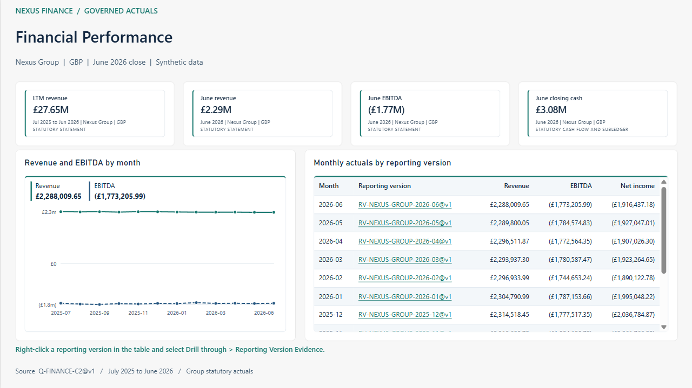
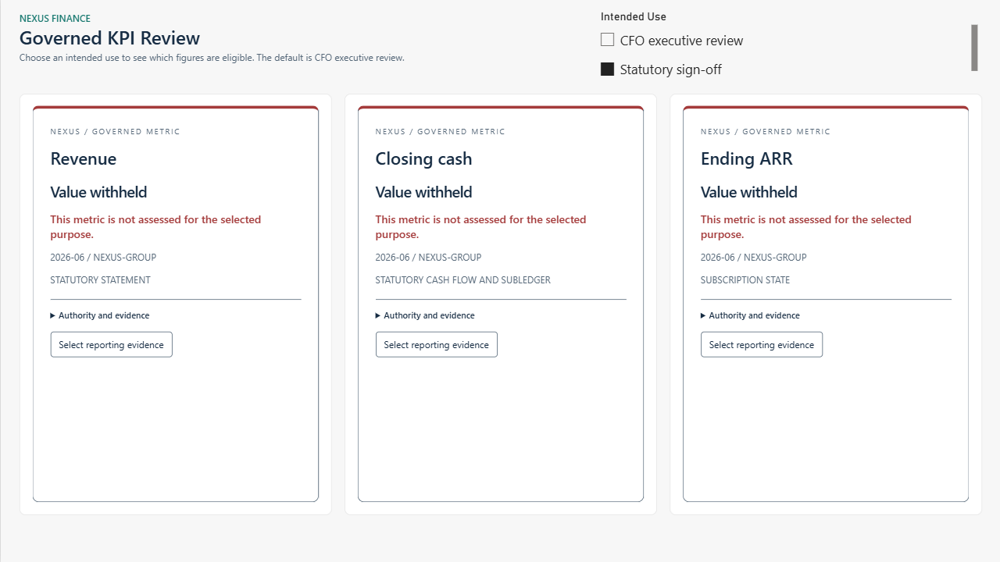
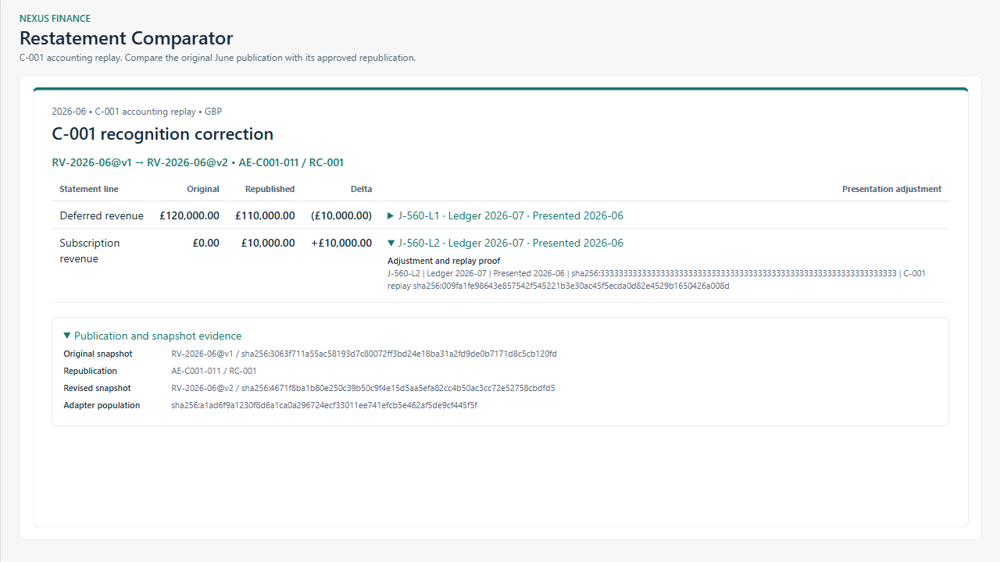

# NexusFinance in Power BI

NexusFinance connects June 2026 Group reporting to close evidence, KPI eligibility, planning variance and accounting restatements. The report uses synthetic data for demonstration. These captures came from the running report in Power BI Desktop using `PrintWindow`, cropped to the report canvas at native resolution. Tall reports show selected viewports. [Power BI report source and setup](../../../consumer-products/power-bi/README.md)

## Financial performance and its evidence

- [Report cover](01-report-cover.png) introduces the synthetic Nexus Group report.
- [Statutory statements](03-statutory-statements.png) compare the June and May income statement and balance sheet.
- [Cash rollforward](11-cash-rollforward.png) bridges opening to closing cash, with the arithmetic tie-out and the source assertion shown separately.
- [Reporting-version evidence](09-reporting-version-evidence.png) opens from the June row above and shows the exact version, close and publication events, reconciliation statuses and source package digest.

## KPI eligibility and close governance

The same revenue, cash and ARR tiles show values for [CFO executive review](05-kpi-executive-review.png) and withhold them for [statutory sign-off](06-kpi-statutory-signoff.png). Each withheld tile gives the reason and identifies its reporting authority.

- [Close governance](07-close-governance.png) shows the five close checks by month for the Group, UK and US scopes.
- [Assurance controls](12-assurance-controls.png) shows the types and replay results for 36 delivery checks and 15 readiness checks. Both panels report zero independent reconciliations.
- [Dataset lineage](10-dataset-lineage.png) shows the declared upstream and downstream dependencies of the liquidity dataset.

## Planning variance and restatement

- [Planning variance](04-planning-variance.png) bridges June budget, the separately labelled synthetic May forecast and June management actuals, with a tie-out for each stage.
- [Restatement comparator](08-restatement-comparator.png) compares original and republished values in the C-001 accounting replay, with the adjustment evidence expanded below.

